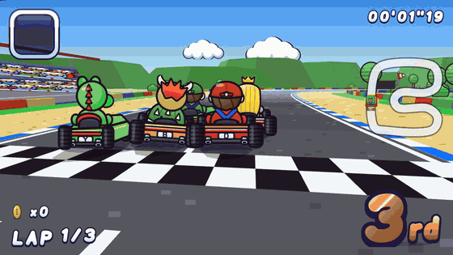
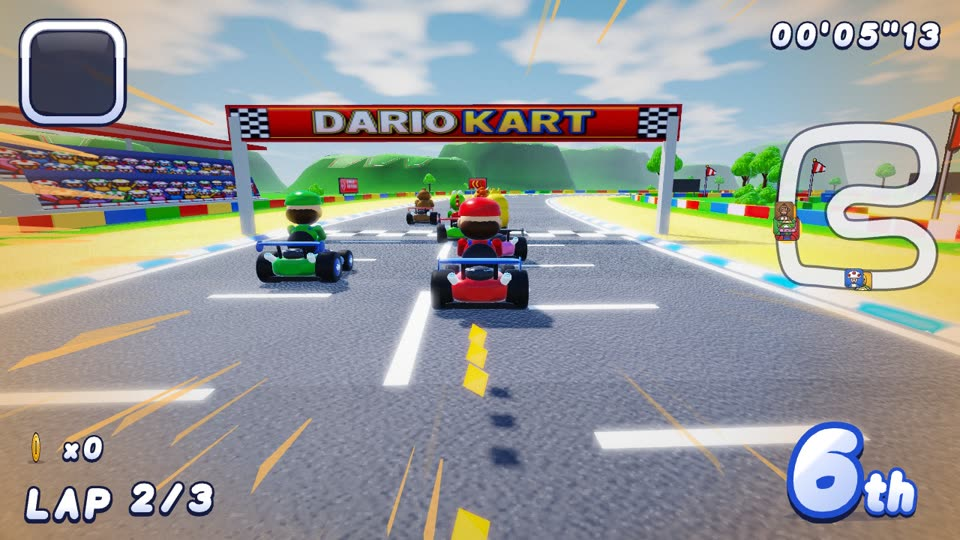
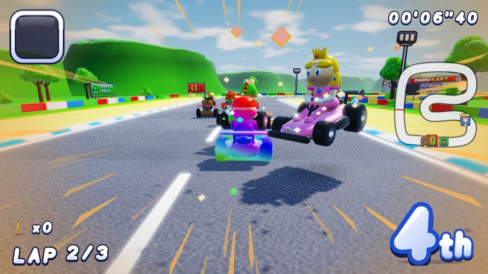
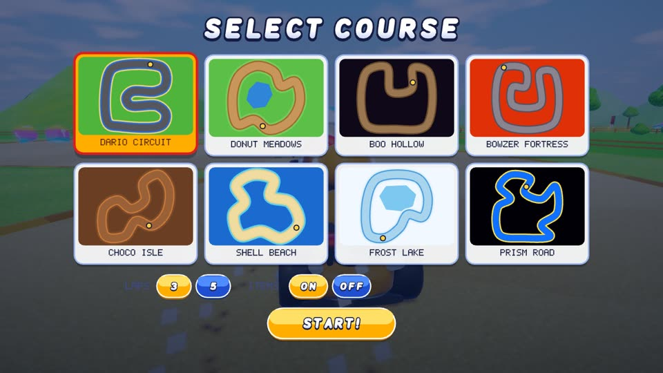
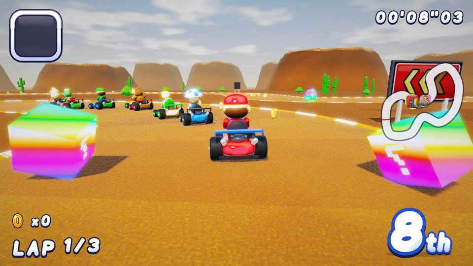
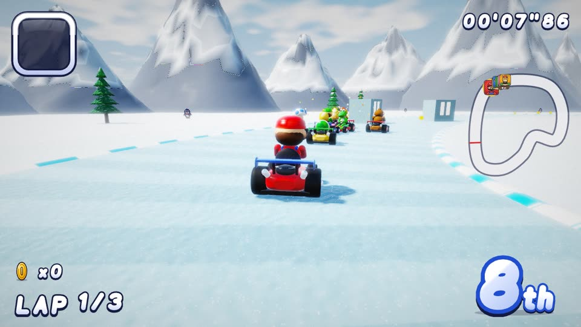
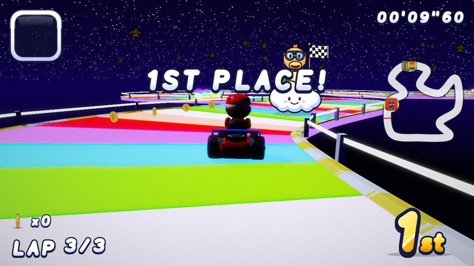

# Dariokart

A Super Mario Kart–inspired kart racer for the web, **rendered entirely with Rive**, with online multiplayer, bots at three difficulty levels, and procedural music and sound effects.

<p align="center">
  
</p>

<p align="center">
  🎬 <a href="docs/media/dariokart-demo.mp4"><b>Watch the full demo with sound (MP4)</b></a>: Rive menus, a race start with the countdown referee, boosts, shells, star power and lightning, five more courses, the finish and results.
</p>

| | | |
|---|---|---|
|  |  |  |
|  |  |  |

- **A real GPU 3D world, written with Rive Scripting.** `rive/world3d` is a Rive file whose Luau layout script drives a WGSL shader through Rive's GPU API, rendering every frame in passes: a sun shadow map, the scene in HDR with 4x MSAA, bloom and a filmic (ACES) composite with vignette and grain. Lighting is physically based (GGX speculars, Fresnel, clear-coat kart paint, polished metal coins and chrome, sky reflections) with soft shadows from karts, trees and walls, translucent foliage swaying in the wind, procedural grass, asphalt, sand, snow, water and glowing lava, smooth noise-shaped hills, snow-capped and rocky mountains, an HDR sky with sun and clouds, and aerial-perspective haze. Karts, a modelled driver for each character (caps, hair, crowns, shells, snouts and eyes), 3D trees, pines, palms, cacti, item boxes, shells, bananas, coins and particles are instanced models. The game builds the meshes and streams the camera and objects into the script through view model data binding. It runs on Rive's WebGL2 runtime (`@rive-app/webgl2-advanced`) at 60 fps, with one camera per player in split screen.
- **AnimaScript effects.** `rive/speedfx` is an AnimaScript (Rive's TypeScript-syntax language, compiled to WebAssembly) layout that draws MK8-style speed lines and a boost glow with Rive paths, driven live by your kart's speed, boost and drift.
- **Rive artboards in the world:** Boos, penguins, moles, flags, lamps, the start banner, turn signs, ad boards and the grandstand crowd are Rive artboards with state machines, baked with the Rive renderer into a sprite atlas that the GPU world draws in its depth-tested pass, so karts, walls and hills hide them correctly. Without WebGL2, or with `?vector`, the whole world falls back to the earlier vector 3D engine drawn with Rive paths.
- **UI in Rive too:** menus, HUD (a vector font made of Rive artboards), place badges, item slot, minimap portraits, the countdown referee and the trophy. The only exception is the native text box used for typing names and room codes, needed for mobile keyboards.
- **Courses modelled on SNES Super Mario Kart** in the style of MK8's retro remakes: Dario Circuit, Donut Meadows, Boo Hollow, Bowzer Fortress, Choco Isle, Shell Beach, Frost Lake and Prism Road.
- **Realtime:** Firebase Realtime Database (rooms, lobby, race state sync, item events).

## Run it

```bash
npm install
npm run dev        # http://localhost:5173
npm run build      # regenerates the .riv, type-checks, bundles into dist/
npm test           # headless races on every course at every difficulty
npm run rive:verify    # type-check the Rive Scripting projects (needs the Rive CLI)
npm run rive:publish   # rebuild + sign rive/world3d and rive/speedfx (needs `rive login`)
```

See [rive/README.md](rive/README.md) for the Rive Scripting projects.

Requires Node 20+. Single-player, Grand Prix, Time Trial and 2P split screen work offline; only online play needs Firebase.

## Game modes

| Mode | Description |
|---|---|
| Grand Prix | Shroom Cup / Star Cup / Special Cup vs 7 bots. Points per race are 9-6-3-1, with a trophy for the top 3. |
| VS Race | A single race vs 7 bots on any course. |
| Time Trial | Solo race against the clock; best times are saved locally. |
| 2P Split Screen | Two local players (top/bottom), with optional bots. |
| Online Multiplayer | Up to 8 racers per room. The host picks the course, laps, items and bot difficulty, and bots fill the empty slots. |

**Bot difficulty:** Easy is 50cc, Medium is 100cc and Hard is 150cc. Higher levels change bot pace, racing line, mistakes, drifting, item use and rubber-banding.

**Courses (two cups of four, plus a Special Cup with all eight):**

| Cup | Course | SNES inspiration | Features |
|---|---|---|---|
| Shroom | Dario Circuit | Mario Circuit | Blue/white curbs, coloured block walls, pipes, grandstand |
| Shroom | Donut Meadows | Donut Plains | Dirt road around a lake |
| Shroom | Boo Hollow | Ghost Valley | Railed boardwalk over the void, Boos |
| Shroom | Bowzer Fortress | Bowser Castle | Lava, thwomps, dash panels |
| Star | Choco Isle | Choco Island | Mud puddles, piranha plants |
| Star | Shell Beach | Koopa Beach | Sand and shallow water |
| Star | Frost Lake | Vanilla Lake | Slippery ice, ice blocks |
| Star | Prism Road | Rainbow Road | Guard rails, thwomps |

**Drivers:** Dario, Luigio, Pearl, Yoshio, Bowzer, Donkey Jr, Toadie, Koopo. Each has its own speed, acceleration, handling and weight.

**Items:** mushroom, banana, green shell, red shell (homing), star, lightning, feather, coins.

**Mechanics:** rocket start, hop and drift with a mini-turbo, dash panels, coins that raise top speed, and a referee who rescues you when you fall off the course.

## Controls

| | Keyboard (1P) | 2P split: P1 / P2 | Gamepad |
|---|---|---|---|
| Accelerate | ↑ / W / X | W / ↑ | A, RT |
| Brake / reverse | ↓ / S / Z | S / ↓ | X |
| Steer | ← → / A D | A D / ← → | Stick, D-pad |
| Hop / drift | Space, Shift, C | F / . | RB, LT |
| Use item (hold ↓ to throw back) | E, Ctrl, V, Enter | G / / | B, LB, Y |
| Pause | Esc / P | Esc | |

On touch devices, on-screen controls appear during races.

## Online multiplayer (Firebase)

Online mode needs your own Firebase project; no keys are committed to this repo. Until a config is provided, the menu marks online play as unavailable and everything else works offline.

1. Create a Firebase project and enable **Realtime Database** and **Authentication → Anonymous**.
2. Copy `.env.example` to `.env.local` and fill in the `VITE_FIREBASE_*` values from Project settings → Your apps → Web app.
3. Deploy the rules: `npx firebase-tools deploy --only database` (they are in `database.rules.json`).
4. Restart `npm run dev`. The menu item **ONLINE MULTIPLAYER** then lets you create a room and share its 4-letter code, or join one.

To try online mode locally without a Firebase project, use the emulator (needs Java 21+):

```bash
npx firebase-tools emulators:start --only database,auth --project demo-dariokart
VITE_FIREBASE_EMULATOR=1 npm run dev
```

Open the game in two different origins, for example two dev servers on different ports, so each tab gets its own anonymous user.

**How sync works:**
- Each client simulates its own kart and sends state at 15 Hz to `rooms/{code}/states/{uid}`.
- Remote karts are interpolated about 120 ms in the past.
- The host simulates the bots.
- Item spawns, removals and lightning are sent through `rooms/{code}/events`.
- Races begin at a shared server timestamp.
- If the host leaves, host duties pass to the next player.

## Rive assets

`public/assets/dariokart.riv` is generated in code. `scripts/rivgen/` contains a binary `.riv` writer: artboards, shapes, paths, gradients, keyframe animations, state machines with inputs and blend states. The art itself is defined in `scripts/rivgen/art/*`.

- `npm run riv` rebuilds the file and validates every artboard against the real Rive runtime.
- `/riv-preview.html` (dev server) previews every artboard and lets you toggle its state machine inputs.

| Artboard(s) | State machine inputs |
|---|---|
| `Logo` | none |
| `Referee` | `stage`, `flag` |
| `Portrait_<id>` | `selected` |
| `Kart_<id>` | `steer`, `boost`, `view` |
| `Item_*` | none |
| `ItemBox`, `ItemPanel` | none |
| `Trophy` | `rank` |
| `Glyph_*` (HUD font) | none |
| `Place_1..8` | `pop` |
| `ItemSlot`, `Lap`, `Banner` | none |
| Props: `Pipe`, `Thwomp`, `Tree`, `Bush`, `Palm`, `DeadTree`, `Mole`, `Cactus`, `Lamp`, `Flag`, `Boo`, `Piranha`, `Penguin`, `IceBlock`, `Cloud` | `Thwomp` has `slam`; the rest have none |
| `TurnSign`, `AdBoard_1..4`, `Crowd` (mapped onto 3D boards) | `TurnSign` has `dir` |
| `Face_<id>` | `mood` |

## Code map

| Path | Contents |
|---|---|
| `src/game/` | Simulation: `race.ts` (physics, items, laps, places), `ai.ts` (bots), `track.ts` and `tracks.ts` (courses), `session.ts` (race loop, cameras, audio, netcode), `hud3d.ts` (Rive HUD), `input.ts` |
| `rive/` | Rive Scripting projects: `world3d/` (Luau + WGSL GPU renderer) and `speedfx/` (AnimaScript speed lines), built with the Rive CLI |
| `src/rive3d/` | The 3D world on the game side: `gpuMesh.ts` (course mesh, item models, billboard sprites, per-frame camera and instance data for the GPU script), `models.ts` (smooth-shaded kart and the eight driver models), `spriteAtlas.ts` (bakes Rive billboard artboards into a texture atlas), `gpuWorld.ts` (hosts `world3d.riv` on the Rive WebGL2 runtime), `view.ts` (camera and projection), `scene.ts` (course solids, Rive art quads, props), `render.ts` (the vector fallback renderer, chase camera) |
| `src/rive/` | Rive runtime, the drawing layer over the Rive renderer, artboard instances, glyph text, `speedFx.ts` (hosts the AnimaScript speed effects) |
| `src/ui/` | `rui.ts` (immediate-mode UI toolkit drawn with Rive: buttons, cards, toggles, sliders; keyboard, mouse, touch and gamepad navigation), `menus.ts` (every screen) |
| `src/audio/` | Procedural chiptune music (10 original tracks), sound effects, engine sound |
| `src/net/` | Firebase connection and multiplayer rooms |
| `scripts/simulate.ts` | Headless test that races every course at every difficulty: `npx tsx scripts/simulate.ts` |
| `scripts/difficulty-report.ts` | Measures bot behaviour per difficulty: `npx tsx scripts/difficulty-report.ts` |

Latest difficulty measurements (all 6 courses, 2 seeds each):

| Difficulty | Avg bot lap | Best bot lap | Drifts per race | Falls per race |
|---|---|---|---|---|
| Easy | 36.0 s | 22.8 s | 0 | 0.0 |
| Medium | 27.9 s | 17.1 s | 0 | 0.4 |
| Hard | 23.7 s | 14.2 s | 35 | 0.5 |

## Demo video

`npm run demo` regenerates the demo video, GIF and screenshots in `docs/media/`. It needs a running dev server, ffmpeg and `npx playwright install chromium` (or set `CHROME_PATH` to an existing Chromium/Chrome).

`scripts/demo/record.mjs` drives the real game in headless Chromium and steps it exactly 1/30 s per frame, so the footage is smooth however fast the machine renders. `scripts/demo/audio.mjs` records the game's own audio engine on the same timeline.

## Contributing

See [CONTRIBUTING.md](CONTRIBUTING.md). CI type-checks, rebuilds and validates the Rive file, runs the headless race tests, builds the bundle and verifies the Rive Scripting projects with the Rive CLI on every push and pull request.

## License and disclaimer

[MIT](LICENSE) © 2026 Pedro Massango.

Dariokart is a non-commercial fan tribute. It is not affiliated with, endorsed by or connected to Nintendo. "Mario Kart" and related names are trademarks of their respective owners. Every character, course, logo, texture, model, piece of music and sound effect here is original: drawn in code, generated procedurally or composed for this project. No assets from any commercial game are included.
