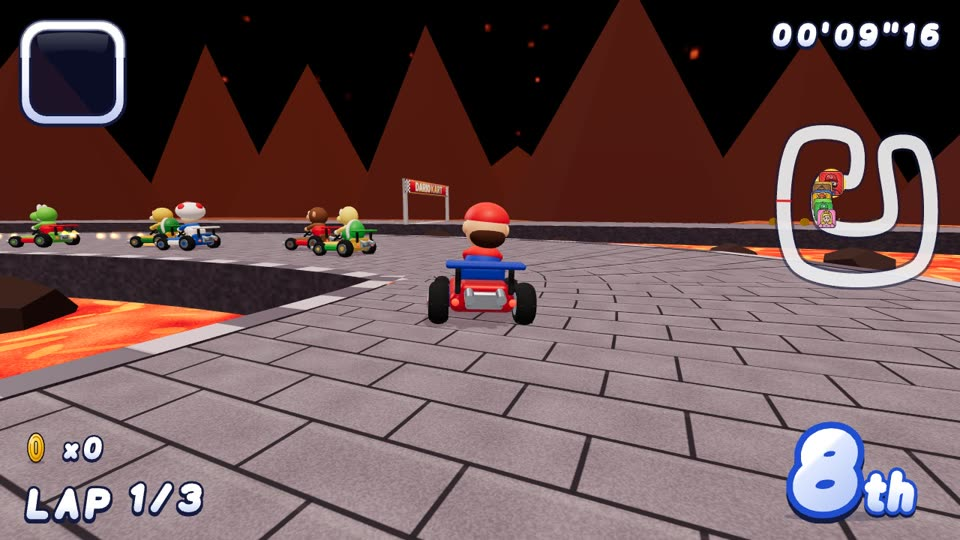

# Dariokart

A Mario Kart–inspired 3D kart racer for the web, with online multiplayer, bots at three difficulty levels, and procedural music and sound effects.

<p align="center">
  
</p>

<p align="center">
  🎬 <a href="docs/media/dariokart-demo.mp4"><b>Watch the full 40-second demo with sound (MP4)</b></a>: menus, a race start with the countdown referee, items, four more courses, the finish and results.
</p>

| | |
|---|---|
|  |  |
|  |  |

- **3D world:** Three.js / WebGL. Courses, karts, characters, item boxes, coins, lighting, shadows, particles.
- **Rive:** every 2D element: logo, menus, character portraits, HUD (a vector font made of Rive artboards), place badges, item slot, item icons, the countdown referee, the trophy. Some Rive artboards also run *inside* the 3D world as live textures (the animated "?" faces on item boxes, the start-gate banner, the thwomp faces).
- **Realtime:** Firebase Realtime Database (rooms, lobby, race state sync, item events).

## Run it

```bash
npm install
npm run dev        # http://localhost:5173
npm run build      # regenerates the .riv, type-checks, bundles into dist/
npm test           # headless races on every course at every difficulty
```

Requires Node 20+. Single-player, Grand Prix, Time Trial and 2P split screen work offline; only online play needs Firebase.

## Game modes

| Mode | Description |
|---|---|
| Grand Prix | Shroom Cup / Star Cup / Special Cup vs 7 bots. Points per race are 9-6-3-1, with a trophy for the top 3. |
| VS Race | A single race vs 7 bots on any course. |
| Time Trial | Solo race against the clock; best times are saved locally. |
| 2P Split Screen | Two local players (top/bottom), with optional bots. |
| Online Multiplayer | Up to 8 racers per room. The host picks the course, laps, items and bot difficulty, and bots fill the empty slots. |

**Bot difficulty:** Easy is 50cc, Medium is 100cc and Hard is 150cc. Higher levels change bot pace, racing line, mistakes, drifting, item use and rubber-banding.

**Courses:** Dario Circuit, Donut Meadows, Boo Hollow, Shell Beach, Bowzer Fortress, Prism Road.

**Drivers:** Dario, Luigio, Pearl, Yoshio, Bowzer, Donkey Jr, Toadie, Koopo. Each has its own speed, acceleration, handling and weight.

**Items:** mushroom, banana, green shell, red shell (homing), star, lightning, feather, coins.

**Mechanics:** rocket start, hop and drift with a mini-turbo, dash panels, coins that raise top speed, and a referee who rescues you when you fall off the course.

## Controls

| | Keyboard (1P) | 2P split: P1 / P2 | Gamepad |
|---|---|---|---|
| Accelerate | ↑ / W / X | W / ↑ | A, RT |
| Brake / reverse | ↓ / S / Z | S / ↓ | X |
| Steer | ← → / A D | A D / ← → | Stick, D-pad |
| Hop / drift | Space, Shift, C | F / . | RB, LT |
| Use item (hold ↓ to throw back) | E, Ctrl, V, Enter | G / / | B, LB, Y |
| Pause | Esc / P | Esc | |

On touch devices, on-screen controls appear during races.

## Online multiplayer (Firebase)

Online mode needs your own Firebase project; no keys are committed to this repo. Until a config is provided, the menu marks online play as unavailable and everything else works offline.

1. Create a Firebase project and enable **Realtime Database** and **Authentication → Anonymous**.
2. Copy `.env.example` to `.env.local` and fill in the `VITE_FIREBASE_*` values from Project settings → Your apps → Web app.
3. Deploy the rules: `npx firebase-tools deploy --only database` (they are in `database.rules.json`).
4. Restart `npm run dev`. The menu item **ONLINE MULTIPLAYER** then lets you create a room and share its 4-letter code, or join one.

To try online mode locally without a Firebase project, use the emulator (needs Java 21+):

```bash
npx firebase-tools emulators:start --only database,auth --project demo-dariokart
VITE_FIREBASE_EMULATOR=1 npm run dev
```

Open the game in two different origins, for example two dev servers on different ports, so each tab gets its own anonymous user.

**How sync works:**
- Each client simulates its own kart and sends state at 15 Hz to `rooms/{code}/states/{uid}`.
- Remote karts are interpolated about 120 ms in the past.
- The host simulates the bots.
- Item spawns, removals and lightning are sent through `rooms/{code}/events`.
- Races begin at a shared server timestamp.
- If the host leaves, host duties pass to the next player.

## Rive assets

`public/assets/dariokart.riv` is generated in code. `scripts/rivgen/` contains a binary `.riv` writer: artboards, shapes, paths, gradients, keyframe animations, state machines with inputs and blend states. The art itself is defined in `scripts/rivgen/art/*`.

- `npm run riv` rebuilds the file and validates every artboard against the real Rive runtime.
- `/riv-preview.html` (dev server) previews every artboard and lets you toggle its state machine inputs.

| Artboard(s) | State machine inputs |
|---|---|
| `Logo` | none |
| `Referee` | `stage`, `flag` |
| `Portrait_<id>` | `selected` |
| `Kart_<id>` | `steer`, `boost`, `view` |
| `Item_*` | none |
| `ItemBox`, `ItemPanel` | none |
| `Trophy` | `rank` |
| `Glyph_*` (HUD font) | none |
| `Place_1..8` | `pop` |
| `ItemSlot`, `Lap`, `Banner` | none |
| Props: `Pipe`, `Thwomp`, `Tree`, `Bush`, `Palm`, `DeadTree`, `Mole` | `Thwomp` has `slam`; the rest have none |

## Code map

| Path | Contents |
|---|---|
| `src/game/` | Simulation: `race.ts` (physics, items, laps, places), `ai.ts` (bots), `track.ts` and `tracks.ts` (courses), `session.ts` (race loop, cameras, audio, netcode), `hud3d.ts` (Rive HUD), `input.ts` |
| `src/three/` | 3D world: `world.ts` (course geometry, scenery, pickups, particles, chase camera), `kartMesh.ts` (karts and drivers), `textures.ts` (procedural textures), `riveTexture.ts` (Rive → WebGL textures) |
| `src/rive/` | Rive runtime, the drawing layer over the Rive renderer, artboard instances, glyph text |
| `src/audio/` | Procedural chiptune music (10 original tracks), sound effects, engine sound |
| `src/net/` | Firebase connection and multiplayer rooms |
| `src/ui/menus.ts` | Menus, lobby, results, Grand Prix flow |
| `scripts/simulate.ts` | Headless test that races every course at every difficulty: `npx tsx scripts/simulate.ts` |
| `scripts/difficulty-report.ts` | Measures bot behaviour per difficulty: `npx tsx scripts/difficulty-report.ts` |

Latest difficulty measurements (all 6 courses, 2 seeds each):

| Difficulty | Avg bot lap | Best bot lap | Drifts per race | Falls per race |
|---|---|---|---|---|
| Easy | 36.0 s | 22.8 s | 0 | 0.0 |
| Medium | 27.9 s | 17.1 s | 0 | 0.4 |
| Hard | 23.7 s | 14.2 s | 35 | 0.5 |

## Demo video

`npm run demo` regenerates the demo video, GIF and screenshots in `docs/media/`. It needs a running dev server, ffmpeg and `npx playwright install chromium`.

`scripts/demo/record.mjs` drives the real game in headless Chromium and steps it exactly 1/30 s per frame, so the footage is smooth however fast the machine renders. `scripts/demo/audio.mjs` records the game's own audio engine on the same timeline.

## Contributing

See [CONTRIBUTING.md](CONTRIBUTING.md). CI type-checks, rebuilds and validates the Rive file, runs the headless race tests and builds the bundle on every push and pull request.

## License and disclaimer

[MIT](LICENSE) © 2026 Pedro Massango.

Dariokart is a non-commercial fan tribute. It is not affiliated with, endorsed by or connected to Nintendo. "Mario Kart" and related names are trademarks of their respective owners. Every character, course, logo, texture, model, piece of music and sound effect here is original: drawn in code, generated procedurally or composed for this project. No assets from any commercial game are included.
